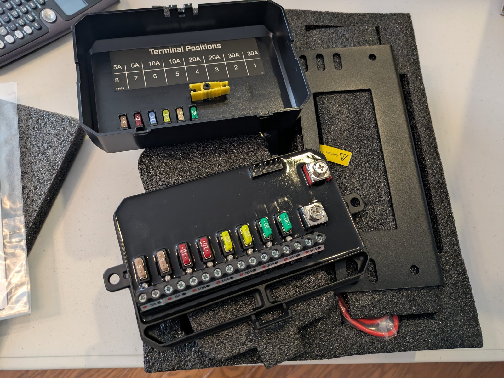
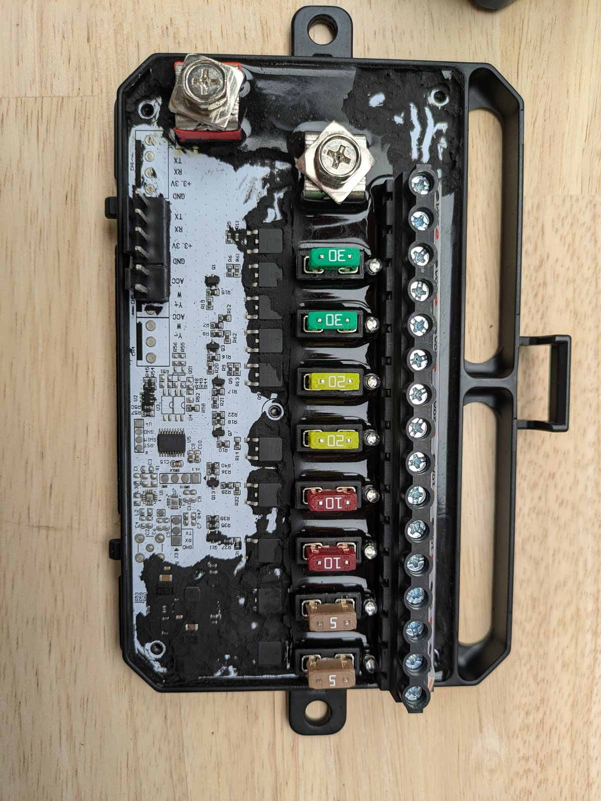
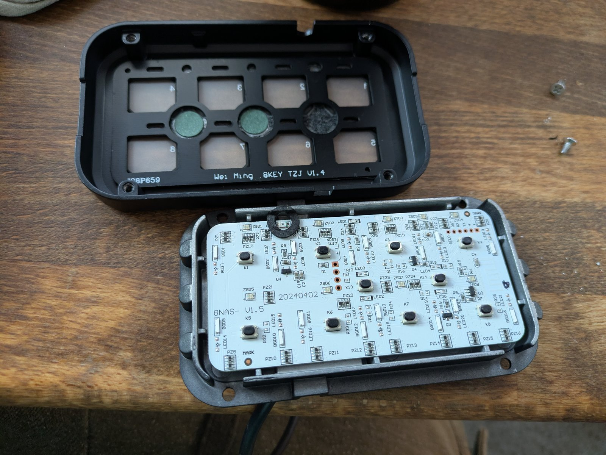
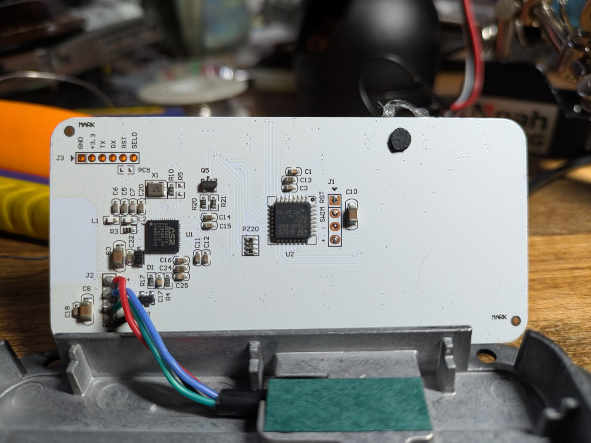
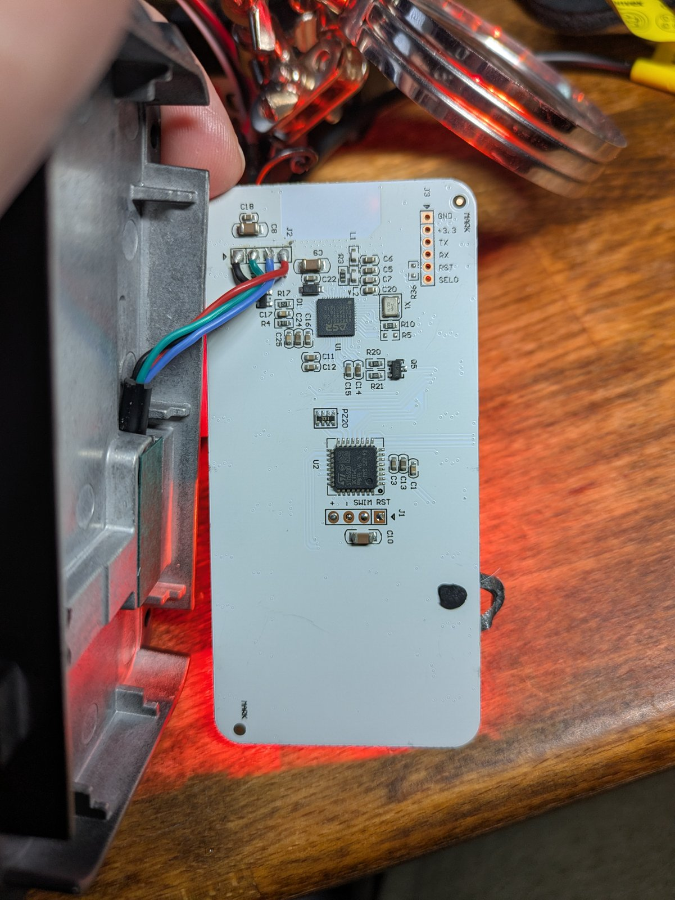

# ROADSHOCK Universal LED 8-Gang Switch Panel: Reverse Engineering

**Harbor Freight SKU 71426** ·
[product page](https://www.harborfreight.com/universal-led-8-gang-switch-panel-71426.html) ·
[owner's manual](https://manuals.harborfreight.com/manuals/71000-71999/71426-193175548276.pdf)
(PDF link, not redistributed here)

Firmware analysis, pinouts, wire protocol, and a practical path to a
CAN-controlled power distribution unit (PDU) built on the stock hardware.


*ROADSHOCK 71426 base/output unit, lid removed. The terminal/fuse map is printed inside.*

This is a community reverse-engineering project for the **Harbor Freight 71426**
8-gang switch panel system (also sold under related brand names). It covers both
boards:

- the **base board** (the power/output module), and
- the **button panel** (the 8-button remote with RGB status LEDs).

Everything here was obtained from hardware the author owns: SWIM dumps of two
unprotected STM8 microcontrollers, static analysis, and passive UART captures.
No vendor source code is included.

---

## At a glance

| Item | Finding |
|---|---|
| Product | **ROADSHOCK Universal LED 8 Gang Switch Panel**, Harbor Freight **SKU 71426** |
| Base MCU | **STM8S003F3P6**, TSSOP-20, 8 KB flash, ROP **open** |
| Button-panel MCU | **STM8S003K3**, LQFP-32, 8 KB flash, ROP **open** |
| Panel BLE SoC | **ASR5601S**, QFN-48 (main panel controller; BLE does not advertise in this variant) |
| Base ↔ panel link | UART, **2400 baud 8N1**, 11-byte frames, additive checksum |
| Panel display link | UART, **115200 8N1**, 9-byte `0x5A … 0xEE` frames, 8 nibbles = 8 RGB LEDs |
| Base outputs | 8 channels; stock is on/off only; our firmware adds **hardware PWM** (TIM1) |
| Output stage | 8 × **D30PW40A** high-side P-FETs; channels **1–2 (30 A) use two in parallel** |
| Per-channel fuses | 1–2: 30 A · 3–4: 20 A · 5–6: 10 A · 7–8: 5 A |
| Current sensing | **None** on the stock board |
| Bench CAN | **Adafruit RP2040 CAN Bus Feather** (MCP25625); used for early tests, not in the current design |
| ADC / I2C in stock firmware | **Unused** in both STM8 images |
| Custom base firmware | SDCC 4.5, ~2.6 KB of the 8 KB flash |

---

## The two boards

<table>
<tr>
<td width="50%"></td>
<td width="50%"></td>
</tr>
<tr>
<td><em>Base/output unit: 8 fused outputs, D30PW40A high-side MOSFETs, STM8S003F3P6.</em></td>
<td><em>Button panel top side: 8 tactile buttons and RGB LEDs.</em></td>
</tr>
<tr>
<td></td>
<td></td>
</tr>
<tr>
<td><em>Button panel PCB (bottom): ASR5601S (U1), STM8S003K3 (U2).</em></td>
<td><em>J3 (ASR UART1 / boot mode) and the J2 cable.</em></td>
</tr>
</table>

### Base board

- STM8S003F3P6 (TSSOP-20), 8 KB flash, 1 KB RAM.
- 8 output channels on a 12-entry `{port, mask}` table:
  **PA3, PA2, PC7, PC6, PC5, PC4, PC3, PD2**.
- High-side output stage: **D30PW40A** P-channel MOSFETs (TO-263, 30 A / 40 V),
  driven by **FMMT493** NPNs; channels **1–2 use two FETs in parallel**.
- Fuse ratings, terminals 1–8: **30, 30, 20, 20, 10, 10, 5, 5 A**.
- One digital input: **PA1 = ACC/ignition sense**.
- No ADC, no I2C, no current sense.
- SWIM programming header; option bytes unprotected.

### Button panel

Two processors with a clear split:

| Part | Role |
|---|---|
| **ASR5601S** (U1) | Main panel controller: scans the 8 buttons, runs the UI, speaks the 2400-baud base link, optional BLE |
| **STM8S003K3** (U2) | RGB LED display driver: 8 × RGB LEDs on 24 GPIOs, receives 115200 display frames |

The STM8 has **no button inputs**. All 24 GPIOs are outputs. The buttons are on
the ASR.

The top side of the panel carries the 8 tactile buttons (K1–K8) and the RGB
LEDs; the bottom side carries the ASR and the STM8.

---

## Protocol at a glance

### Base ↔ panel: 2400 baud, 11 bytes

```
seq  dir  type  flag  p0 p1 p2 p3 p4 p5  sum
```

- `dir` = `0x00` panel → base, `0xFF` base → panel
- reply type = `type | 0x10`
- `sum` = 8-bit sum of all preceding bytes
- `0x08 0x0C` = live button bitmask
- `0x07` = master power / configuration (`flag` 0x00 = off, 0x01 = on)
- Replies: `0x18` (11 bytes) or `0x17` (12 bytes, one extra status byte)

Example (verified on the wire):

```
panel: 19 00 08 0c 62 40 20 02 00 00 f1
base : 19 ff 18 00 62 40 20 02 00 00 f4
```

### ASR → STM8 display: 115200 baud, 9 bytes

```
5A  xx  [n01] [n23] [n45] [n67]  xx  xx  EE
```

- Four payload bytes = eight nibbles, one per RGB LED.
- Each nibble selects a 3-pin pattern (colour).
- The STM8 checks only `[0]==0x5A`, `[8]==0xEE`, length 9.

See [`docs/protocol.md`](docs/protocol.md) and
[`docs/panel.md`](docs/panel.md) for the full decode.

---

## Pinouts

### Base outputs

| Channel | Port pin | Notes |
|---|---|---|
| 1 | PA3 | |
| 2 | PA2 | |
| 3 | PC7 | |
| 4 | PC6 | |
| 5 | PC5 | |
| 6 | PC4 | TIM1_CH4 (hardware PWM) |
| 7 | PC3 | |
| 8 | PD2 | |
| n/a | PA1 | ACC/ignition sense (input) |

Entries 8–11 of the firmware table are PB4 spares.

### Button panel RGB LEDs

| Channel | pin1 | pin2 | pin3 |
|---|---|---|---|
| 0 | PA1 (2) | PA2 (3) | PA3 (7) |
| 1 | PF4 (8) | PB7 (9) | PB6 (10) |
| 2 | PB5 (11) | PB4 (12) | PB3 (13) |
| 3 | PB2 (14) | PB1 (15) | PB0 (16) |
| 4 | PE5 (17) | PC1 (18) | PC2 (19) |
| 5 | PC3 (20) | PC4 (21) | PC5 (22) |
| 6 | PC6 (23) | PC7 (24) | PD0 (25) |
| 7 | PD2 (27) | PD3 (28) | PD4 (29) |

Numbers in brackets are LQFP-32 package pins. Full tables, including the
ASR5601S QFN-48 map, are in [`docs/pinouts.md`](docs/pinouts.md).

---

## What works today

- **Read the base firmware**: SWIM dump, 8 KB flash + 128 B EEPROM.
- **Read the panel firmware**: same, ROP open.
- **Capture the 2400-baud bus** with a Feather RP2040 (listen-only or MITM).
- **Injection**: button frames, master power, and our custom `0x09` PWM
  command.
- **Hardware PWM** on channel 6 at 200–2000 Hz, 10–100 % duty
  (TIM1, verified on a scope).
- **Build custom base firmware** with SDCC 4.5.
- **Restore the stock firmware** from verified images at any time.

---

## What is still open

- The **ASR5601S firmware** has not been dumped. Its button/UI logic is the one
  remaining black box. SWD (P06/P07) is the reliable dump route. The J3 UART
  monitor also has a documented read candidate, `coredump flash all`, which is
  read-only and needs no licence. See
  [`docs/asr5601_dump_plan.md`](docs/asr5601_dump_plan.md).
- Direct control of the panel LEDs without touching the private 115200 link.
  Over J2 alone, the LEDs remain under the ASR's UI control.
- The final CAN gateway/PDU hardware (CAN controller choice, current sensing).

---

## Test hardware

The bench used an Adafruit Feather RP2040 DVI for UART capture and an
**Adafruit RP2040 CAN Bus Feather (MCP25625)** for early CAN testing. The CAN
Feather is not part of the current design and is not actively used. See
[`docs/test-hardware.md`](docs/test-hardware.md).

## Repository layout

```
docs/       human-readable documentation
dumps/      stock flash / EEPROM / option bytes + SHA-256
restore/    stock restore images and script
reverse/    decompiled firmware + annotated listings
firmware/   custom base firmware (SDCC source + prebuilt images)
tools/      protocol reference, PWM tests, Ghidra scripts
rp2040/     CircuitPython sniffer, impersonator, base emulator, CAN sketch
captures/   real bus captures
images/     board photos (EXIF/GPS stripped)
```

---

## Quick start

```bash
# 1. Protocol reference self-test (no hardware)
python3 tools/protocol_ref.py

# 2. Validate a dump
python3 tools/validate_dump.py dumps/base/flash.bin 8192

# 3. Capture the live 2400-baud link with a Feather RP2040
#    copy rp2040/dual_listen.py to CIRCUITPY as code.py
#    wire the two signal wires to board.RX and board.D9, GND to GND

# 3. Build the custom base firmware (SDCC 4.5 in PATH)
cd firmware && make
```

Build, flash, and restore details are in
[`docs/reproduce.md`](docs/reproduce.md).

---

## Status and confidence

Findings are tagged where it matters:

- **Verified**: read from the firmware or measured on hardware.
- **Inferred**: consistent with the evidence but not proven.
- **Unknown**: not yet determined.

The protocol, pin maps, dump integrity, PWM behaviour, and the STM8 display
driver are verified. The ASR firmware and any J2-only LED control are not.

---

## Safety

This is 12 V automotive hardware. Fuse every output, never work on it live,
and do not use this project for safety-critical systems. The authors accept no
liability for damage or injury.

---

## Legal and licence

Original code and documentation in this repository are released under the MIT
licence (see [`LICENSE`](LICENSE)). Stock firmware dumps are provided for
interoperability and research on hardware owned by the author; vendor firmware
remains the property of its respective owners. No vendor source code, ASR BLE
stack, or third-party datasheet is redistributed here. See
[`NOTICE.md`](NOTICE.md).

Harbor Freight and the product names are trademarks of their owners. This
project is not affiliated with or endorsed by Harbor Freight, the OEM, or ASR
Microelectronics.
