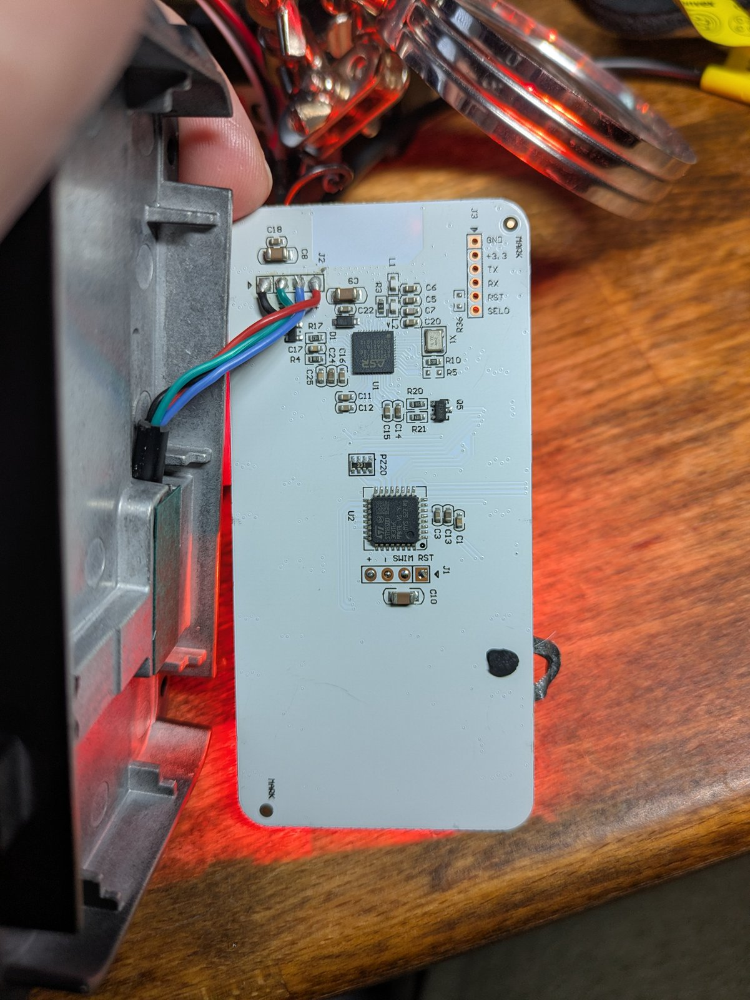

# ASR5601S (QFN-48)

The ASR5601S is the panel's main controller and the only processor whose
firmware we have not dumped.

## Package and pin map

Standard QFN-48: pin 1 at the dot, counterclockwise; the top edge reads
left→right `48 … 37`. The full pin table is in [pinouts.md](pinouts.md#asr5601s-qfn-48).

Key pins:

| Signal | Pin | Notes |
|---|---:|---|
| UART1 TX (P04) | 13 | brought out on J3 |
| UART1 RX (P05) | 14 | brought out on J3 |
| SEL0 (P00) | 40 | boot mode select |
| SEL1 (P01) | 41 | internal pull-down; not on J3 |
| RSTN | 44 | active-low reset, internal 25K pull-up |
| SWCLK / P06 | 37 | SWD clock (top-edge rightmost pin) |
| SWDIO / P07 | 36 | SWD data (right-edge topmost pin) |
| VBATA | 12 | supply |
| VBATB | 22 | 3.3 V bypass |

`SEL0 = 1` at reset selects the UART boot/download mode; `SEL0 = 0` boots the
application from flash.

## J3 header

| Pad | Signal |
|---|---|
| `GND` | ground |
| `+3.3` | 3.3 V |
| `TX` | ASR P04 / UART1 TX (pin 13) |
| `RX` | ASR P05 / UART1 RX (pin 14) |
| `RST` | ASR RSTN (pin 44) |
| `SEL0` | ASR P00 (pin 40) |

J3 does **not** reach the panel STM8. It is the ASR's own UART1 breakout.

## Bootloader

ASR documents a UART download mode:

- `SEL1 = 0`, `SEL0 = 1`, reset.
- **115200 8N1**, UART1 on P04/P05.
- The chip prints **`1F2E3D00`** when ready (`1F2E3D81` = communication error).
- ASR's DOGO tool then speaks a proprietary download protocol.

The public documentation covers **download and erase only**. There is no
documented read/flash-dump command.

## Dump options

1. **SWD**: P06 (pin 37) = SWCLK, P07 (pin 36) = SWDIO, plus GND and 3.3 V.
   The flash is memory-mapped at `0x10000000`, so a CMSIS-DAP/J-Link can read it
   directly with no flash algorithm. Requires micro-soldering or a pogo fixture,
   and the debug port must not be locked.
2. **DOGO UART read path**: ASR's manual documents download and erase only, but
   DOGO VP2.3.8 is a PyInstaller Python build and contains `read_image`,
   `recv_flash_image`, `dumping done!!!` and coredump paths. See
   [asr5601_reference_archive.md](asr5601_reference_archive.md). `read_image`
   is a host capture flag, not a command. The bootloader is a text CLI
   (`welcome to download` / `>>>`), so the first bench probe is a bare CRLF and
   `help`, not a read command. The full procedure is in
   [asr5601_dump_plan.md](asr5601_dump_plan.md).
3. **App-level UART**: ASR demos often use UART1 as a log/AT port. If this app
   does, J3 gives logs/commands, not a flash dump.

There is no external flash: the 1 MB is inside the SiP.

## BLE

A BLE scan with the panel powered showed **no advertisements**. That means BLE
is not advertising in this variant, not that the ASR is blank: the panel's
buttons work, so the ASR is running.

If the BLE path is ever wanted, the SWD route above is the way in. Do not flash
the ASR until a backup exists. There is no factory restore image.

## Cautions

- The ASR's UART may be shared with J2. During a bootloader session, disconnect
  J2 or hold the other node quiet, or multiple drivers will fight.
- The ASR is a 3.3 V part in this design; its I/O is not 5 V tolerant.
- The QFN is 0.4 mm pitch. Probe with care.
