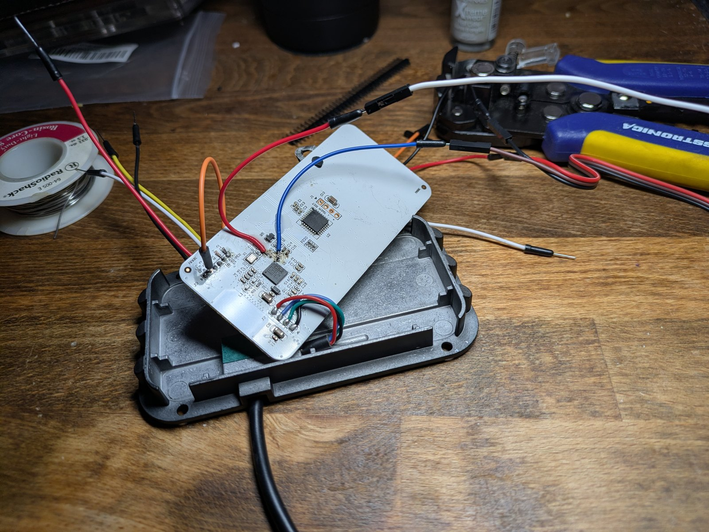
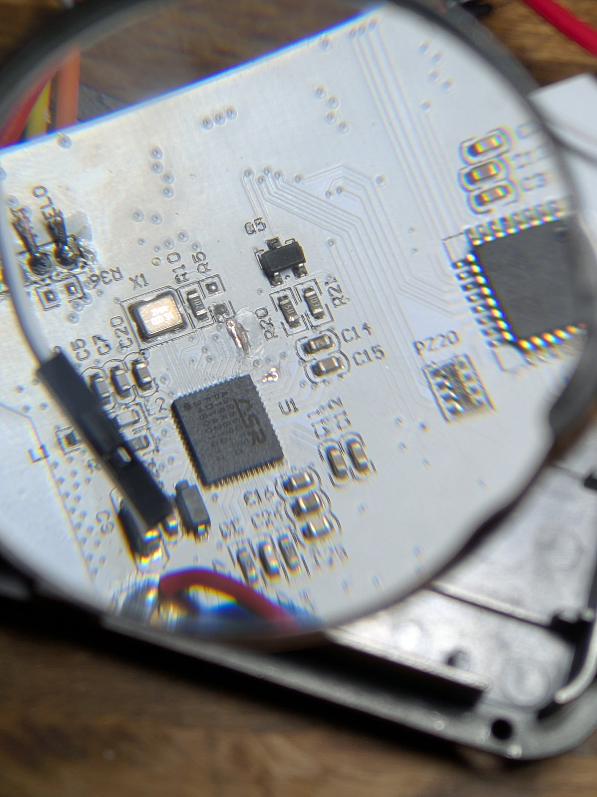

# ASR5601S SWD dump

How to read the ASR5601S SiP flash over SWD with an ST-Link. This is the
fallback path in [asr5601_dump.md](asr5601_dump.md); the UART paths
are documented there and are not usable on this unit.

The procedure is read-only. It sends `init`, `halt`, `mdw` and `dump_image`
and nothing else.

## Bench record for this panel


*Panel out of its case with the two SWD wires soldered to the vias on the traces from U1 pins 36 and 37, plus ground.*


*U1, the ASR5601S, and the via area next to PZ20 where the SWD wires attach.*

What was actually done:

- Panel powered from J2 at 3.3 V with no base board connected.
- Two thin wires soldered to the vias on the traces from U1 pin 37 (`P06`,
  SWCLK) and pin 36 (`P07`, SWDIO). Both vias have no other connection, so they
  are dedicated test points.
- The J3 pad labeled `RST` is not the ASR reset. No reset wire was used.
  Download mode was entered with a jumper from J3 `SEL0` to J3 `+3.3` and a
  power cycle, which leaves the ROM monitor running and the application stopped.
- ST-Link V2 clone, VTREF taken from the board 3.3 V rail, common ground.
- OpenOCD 0.12, adapter speed requested at 1000 kHz and settled at 950 kHz.
  DPIDR `0x0bc11477`, Cortex-M0+ r0p1.
- Two independent 1 MB reads, byte-identical
  (`b7b92dab982a262b6e2dc295bf7b2781ce070091b58d6b82c5a0596a9ba163fb`).

Why SWD instead of UART: the ROM monitor at 115200 accepts `init` but rejects
`get_chip_type`, `help` and `coredump` with status `87`, and the application log
port at 921600 answers `ERROR` to every text command. Neither exposes a read
command on this unit.

## What you need

| Item | Notes |
|---|---|
| ST-Link V2 | any common clone works, firmware V2J24 or newer |
| OpenOCD 0.12 | `winget install xpack-dev-tools.openocd-xpack` |
| Two fine wires | soldered to the vias on the traces from QFN pins 36 and 37 |
| Ground wire | any board ground |
| 3.3 V feed to J2 | the panel powers itself |

## Wiring

| ST-Link pin | Panel connection |
|---|---|
| `SWCLK` | U1 pin 37, `P06`, or its via |
| `SWDIO` | U1 pin 36, `P07`, or its via |
| `GND` | board ground |
| `3.3V` (VTREF) | board 3.3 V rail, sense only |

Pin 1 of U1 is the dot at the top-left corner. Pins 37 and 36 are the
top-right corner: 37 is the last pad on the top edge, 36 is the first pad down
the right edge.

Do not power the panel from the ST-Link. The panel gets 3.3 V through J2 and
the ST-Link only senses that rail.

## Step 1: prepare the target

1. Solder the wires with the panel unpowered. The vias are easier to solder
   than the 0.4 mm QFN pads.
2. Check continuity from each wire to its QFN pin, and check that the two
   wires do not short to each other or to ground.
3. Fit the `SEL0` to `+3.3` jumper.
4. Power the panel through J2, which starts the ROM monitor instead of the
   application.
5. Check the idle level on both wires. Both should sit near 3.3 V.

The application repurposes `P06` and `P07` in its pin setup, which removes SWD
after boot. The display link is not involved; UART3 is on P13/P14. The reliable sequence is the `SEL0` to `+3.3` jumper
plus a power cycle: the chip stays in the ROM download monitor and never starts
the application. Attaching quickly after a normal power cycle is not reliable
because the remap happens early in the boot.

### Boot strap behavior, measured

- `SEL0` is sampled at power-on only. A soft reset through SWD returns to the
  ROM monitor even when `SEL0` is low at that moment.
- To run the application, power-cycle with `SEL0` low.
- The Feather helper `rp2040/asr_mon.py` has a `SEL0_AT_BOOT` constant. With it
  set to `True` the Feather drives `SEL0` high as soon as it boots, so powering
  the board afterwards selects the ROM monitor. Set it to `False` for a session
  where the application must run.
- If the Feather is powered from the same rail as the panel, it restarts during
  a panel power cycle and drops `SEL0`. Power the Feather from USB, or hold
  `SEL0` with a physical jumper to `+3.3`.

## Step 2: probe the debug port

```bash
python tools/asr5601_swd_dump.py --probe
```

A working connection prints a program counter, the first words at
`0x10000000`, and:

```
RESULT: debug port open and memory readable.
```

If OpenOCD reports an IDCODE mismatch, the wiring or the power is wrong. If it
reports no device, the ST-Link is not visible over USB.

## Step 3: read the flash

```bash
python tools/asr5601_swd_dump.py --dump dumps/asr --twice --trim
```

This reads 1 MB from `0x10000000` twice, compares the SHA-256, writes
`SHA256SUMS`, and writes a trimmed copy if the tail is all `0xFF` (the 512 KB
part).

For a 512 KB part:

```bash
python tools/asr5601_swd_dump.py --dump dumps/asr --size 512k --twice
```

The same read by hand:

```bash
openocd -f interface/stlink.cfg -f tools/openocd/asr5601_swd.cfg \
  -c "adapter speed 100" -c "init" -c "halt" \
  -c "dump_image dumps/asr/asr_flash.bin 0x10000000 0x100000" \
  -c "shutdown"
```

## Step 4: verify the image

1. The two reads must have the same SHA-256. Any difference means retry.
2. The vector table at `0x10000000` should hold a stack pointer near
   `0x2000xxxx` and a reset vector that points into flash.
3. A string scan should find BLE names, UUIDs and readable code, not just
   `0xFF` padding.

Then carve the partitions with
[asr5601_reference_archive.md](asr5601_reference_archive.md) and the memory
layout note in `reference/asr560x/drive/ASR560X_test_image_layout.md`.

## Troubleshooting

| Symptom | Cause | Action |
|---|---|---|
| `openocd not found` | not installed | `winget install xpack-dev-tools.openocd-xpack`, then reopen the shell |
| IDCODE mismatch | wiring, ground, or target power | recheck continuity and the 3.3 V rail |
| No device found | ST-Link USB or driver | try another port, check Device Manager |
| IDCODE reads, `0x10000000` does not | read protection | stop; the flash is locked |
| Read returns all `0xFF` | wrong base address or locked region | confirm `0x10000000`, then stop |
| Only works at 100 kHz | long wires or series parts | keep 100 kHz; speed is not needed |
| Two reads differ | signal integrity or power | lower the speed, shorten wires, retry |
| Cannot halt after boot | app repurposed `P06`/`P07` | use the `SEL0` jumper and a power cycle |

## What the image contains

| Offset | Address | Size | Contents |
|---|---|---|---|
| `0x00000` | `0x10000000` | 32 KB | bootloader |
| `0x0D000` | `0x1000D000` | | BLE ROM |
| `0x48000` | `0x10048000` | | application |
| `0xF0000` | `0x100F0000` | | ATE |

Offsets are from the ASR test image layout and have not been confirmed on this
panel yet.

## Safety

- Never send `erase`, `burn`, `boot` or `program`. There is no factory restore
  image for this chip.
- Keep the panel on its own 3.3 V supply.
- If the debug port is locked, stop. Decapsulation is out of scope.
