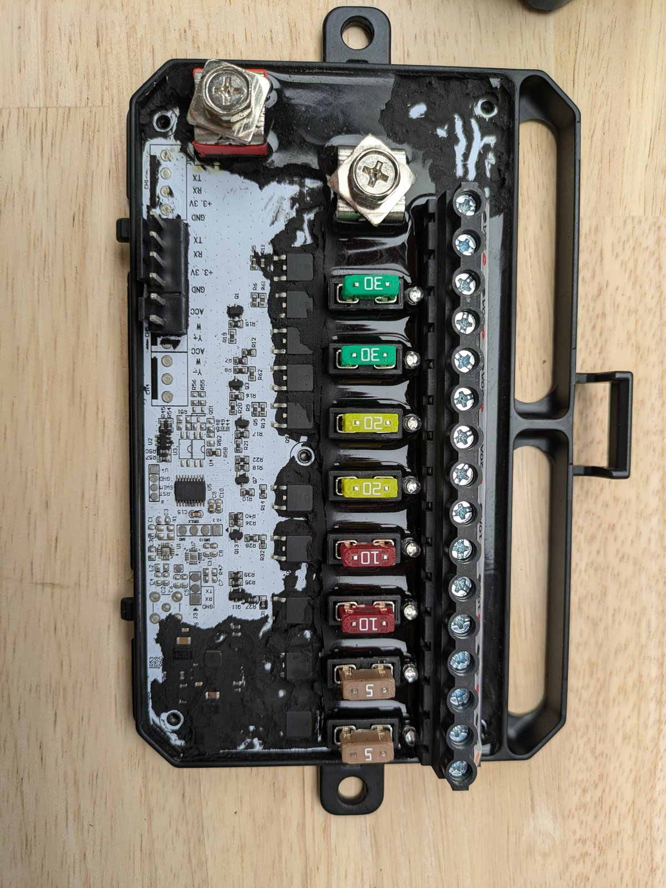
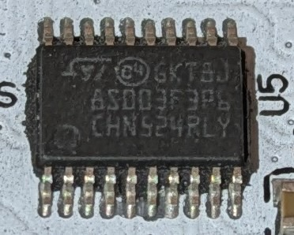
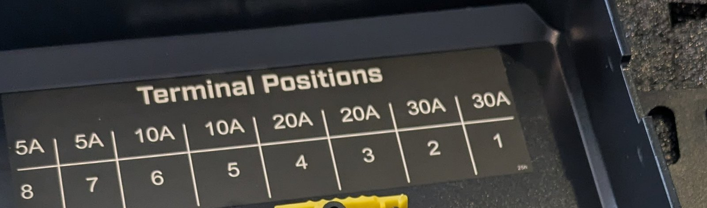
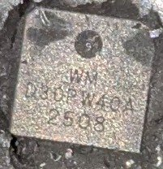
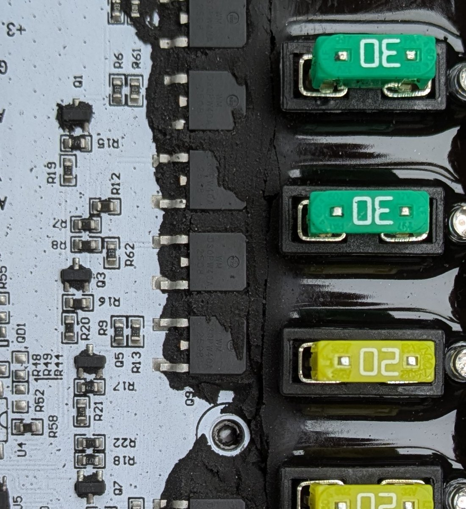
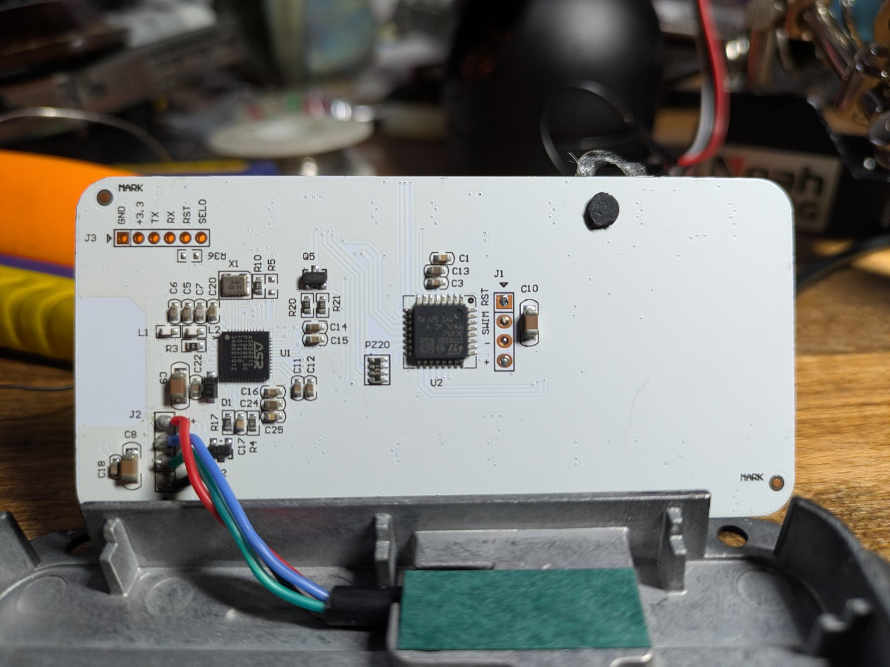
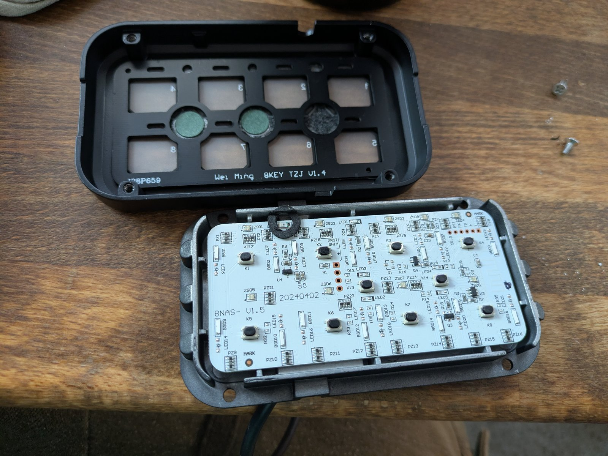
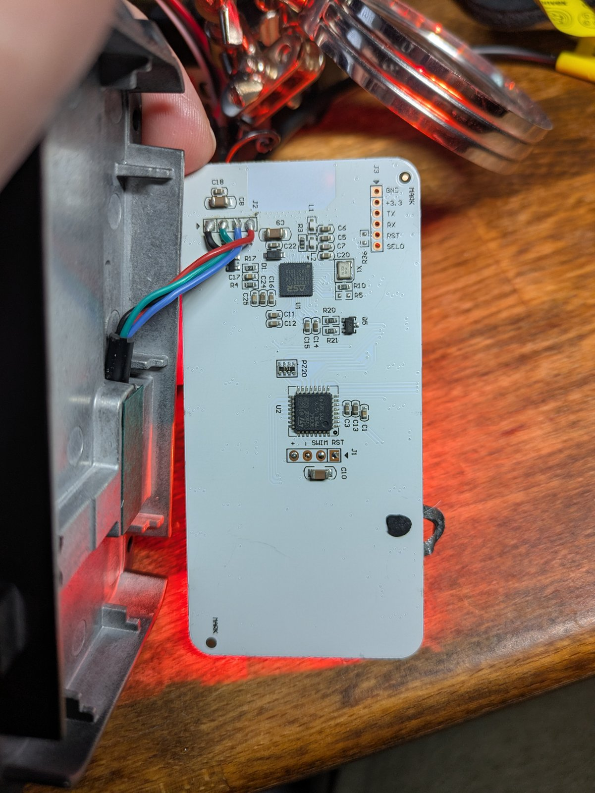

# Hardware

**Product:** ROADSHOCK Universal LED 8 Gang Switch Panel,
**Harbor Freight SKU 71426**.
[Product page](https://www.harborfreight.com/universal-led-8-gang-switch-panel-71426.html) ·
[owner's manual](https://manuals.harborfreight.com/manuals/71000-71999/71426-193175548276.pdf).

## Base board (power/output module)

*Base/output unit: the eight fused outputs and the power stage, inside its case.*

The base is the board with the fused outputs and the switch panel connector.

*Base MCU: STM8S003F3P6 in TSSOP-20 (marking `003F3P6`, lot `CHN524RLY`).*

| Item | Value |
|---|---|
| MCU | **STM8S003F3P6**, TSSOP-20, 8 KB flash, 1 KB RAM |
| Clock (stock) | HSI 16 MHz master, CPU 2 MHz (`CKDIVR = 0x18`) |
| Link | UART1, 2400 8N1, on PD5 (TX) / PD6 (RX) |
| Outputs | 8 channels, active-high, through a 12-entry `{port, mask}` table |
| Input | PA1 = ACC/ignition sense |
| Watchdog | IWDG in the stock image |
| Programming | SWIM header (`V+`, `GND`, `SWIM`, optionally `RST`) |
| Protection | ROP byte `0x00` (**unprotected**) |

Output map (verified from the firmware table and by measurement):

| Ch | Pin | Ch | Pin |
|---|---|---|---|
| 1 | PA3 | 5 | PC5 |
| 2 | PA2 | 6 | PC4 (TIM1_CH4) |
| 3 | PC7 | 7 | PC3 |
| 4 | PC6 | 8 | PD2 |

The firmware table has 12 entries; entries 8–11 are PB4 spares.

### Hardware PWM (TIM1) per channel

The STM8S003F3P6 has one advanced timer (TIM1) with four independent compare/capture
channels. Only four of the eight output pins connect to TIM1 channels:

| Channel | Pin | TIM1 channel | Notes |
|---|---|---|---|
| 1 | PA3 | — | GPIO only (no TIM1) |
| 2 | PA2 | — | GPIO only (no TIM1) |
| 3 | PC7 | CH2 | Independent frequency & duty |
| 4 | PC6 | CH1 | Independent frequency & duty |
| 5 | PC5 | — | GPIO only (no TIM1) |
| 6 | PC4 | CH4 | Independent frequency & duty |
| 7 | PC3 | CH3 | Independent frequency & duty |
| 8 | PD2 | — | GPIO only (no TIM1) |

**Key implications:**
- **Frequency is shared per TIM1 timer**: all four PWM channels run at the same
  frequency (set by ARR/PSC). Individual duty cycles are per-channel (CCRx).
- **Channels 1, 2, 5, 8**: cannot do hardware PWM — software PWM only (via 2 ms tick).
- **Channels 3, 4, 6, 7**: full hardware PWM (50–2000 Hz, 0–100% duty).
- The custom firmware `PROTO_TYPE_CONFIG` (type 0x09) with `mode=2` enables PWM
  on supported channels. On unsupported channels it falls back to steady on/off.

### Output stage

Each gang is high-side switched by a **P-channel D30PW40A** (TO-263 / D2PAK,
30 A / 40 V), driven through a SOT-23 **FMMT493** NPN (marking `493`) with a
gate pull-up. MCU high → NPN on → gate low → P-FET on; the channels are
active-high.

**Channels 1 and 2 (the 30 A outputs) use two D30PW40A devices in parallel.**
Channels 3–4 (20 A), 5–6 (10 A) and 7–8 (5 A) use one each.

The terminal label inside the lid gives the order:

| Terminal | 1 | 2 | 3 | 4 | 5 | 6 | 7 | 8 |
|---|---:|---:|---:|---:|---:|---:|---:|---:|
| Fuse | 30 A | 30 A | 20 A | 20 A | 10 A | 10 A | 5 A | 5 A |

*Terminal label inside the lid: 8…1 = 5 A, 5 A, 10 A, 10 A, 20 A, 20 A, 30 A, 30 A.*

*D30PW40A P-channel MOSFET marking (`WM`, `D30PW40A`, `2508`).*

*Output stage: D30PW40A MOSFETs alongside the fuse holders.*

The manual's per-circuit list reads 5, 5, 10, 10, 20, 20, 30, 30 for buttons
1–8; the lid label shows the same group sizes with terminal 1 at 30 A, so use
the label for the physical order.

There is **no current sensing**, no ADC use, and no I2C in the stock firmware.

## Button panel

*Button panel PCB (bottom side): ASR5601S (U1), STM8S003K3 (U2), J3 and the J2 cable.*

*Button panel, top side: 8 tactile buttons (K1–K8), the RGB LEDs, and the `Wei Ming 8KEY TZJ V1.4` case marking.*

The panel contains two processors.

| Ref | Part | Role |
|---|---|---|
| **U1** | **ASR5601S** (QFN-48) | Main panel controller: buttons, UI, 2400-baud link, optional BLE |
| **U2** | **STM8S003K3** (LQFP-32) | RGB LED display driver |

### Headers

*J3 (ASR UART1 / boot mode) and the J2 cable to the base.*

| Header | Pads | Purpose |
|---|---|---|
| **J1** | `+`, `SWIM`, `RST` | STM8 SWIM programming |
| **J3** | `GND`, `+3.3`, `TX`, `RX`, `RST`, `SEL0` | ASR5601S UART1 / boot mode |
| **J2** | 4-wire cable | To the base: power, GND, two 2400-baud signal wires |
| **PZ20** | 6-pin | Unidentified test/programming header (no code evidence yet) |

### What is on which MCU

| Function | Owner |
|---|---|
| 10 buttons (8 channel + power + mode) | **ASR5601S** |
| 8 RGB status LEDs | STM8S003K3, driven by the ASR over 115200 |
| Backlight | Separate always-on / ASR-controlled light |
| 2400-baud base link | ASR5601S (UART1) |
| Display link | ASR5601S → STM8, 115200, 9-byte frames |

The STM8 has **no button inputs**. All 24 of its GPIOs are outputs for the RGB
LEDs. The panel works when connected to the base, but its status LEDs stay dark
when the base is absent, which suggests the ASR is waiting for the base's
start-up handshake.

### ASR5601S power and clock

The datasheet gives these reference connections. The panel's actual passives are
not all confirmed.

| Pin | Signal | Reference connection |
|---:|---|---|
| 12 | VBATA | 1 uF decoupling |
| 19 | VDDAO | 1 uF decoupling |
| 21 | VDDDIG | 1 uF decoupling |
| 22 | VBATB | 1 uF decoupling |
| 23 | VDCSW | 4.7 uH to pin 24 |
| 24 | VDCOUT | 2.2 uF to ground |
| 26/27 | CX2/CX1 | 100 nF flying capacitor |
| 28 | VDDFLSH | 1 uF decoupling |
| 33 | VCCBB | Analog baseband supply |
| 46/47 | XO16MI/XO16MO | 16 MHz crystal |
| 20 | XO32KI | 32.768 kHz crystal input |
| 48 | VCCRFA | RF supply |

The reset pin has an internal 25K pull-up and an 8 ms startup delay after VBATB
reaches 1.7 V.

---

## Identified silicon

| Part | Package | Notes |
|---|---|---|
| STM8S003F3P6 | TSSOP-20 | Base MCU |
| STM8S003K3 | LQFP-32 | Panel RGB LED driver |
| ASR5601S | QFN-48, 6 x 6 mm, 0.4 mm pitch | Panel controller / BLE SoC; Cortex-M0+, 96 KB SRAM, 1 MB or 512 KB SiP flash |
| 16 MHz crystal | n/a | ASR clock |
| 32.768 kHz crystal | n/a | Optional RTC (reference design) |

The panel PCB marking on U1 reads `ASR5601S`, `FD1A21G`, `P19K89-00`.

---

## What is *not* on the hardware

- No CAN transceiver/controller on either stock board.
- No current shunt or current-sense amplifier.
- No external flash on the ASR (1 MB or 512 KB is inside the SiP).
- No light sensor path in the STM8 firmware (the ADC is unused).

The panel has an ambient-light sensor. It is on the ASR side (which has ADC
pins) or in analog backlight circuitry; the STM8 firmware contains no light
sensor path. The ASR firmware has not been dumped, so details remain **?**.

---

## Power and safety

- The base runs from 12 V automotive power.
- Never connect the ST-Link's 3.3 V while the board is powered from 12 V.
- The ST-Link `RST` wire holds the MCU in reset; remove it to run.
- Fuse every output. Do not work on the unit live.
