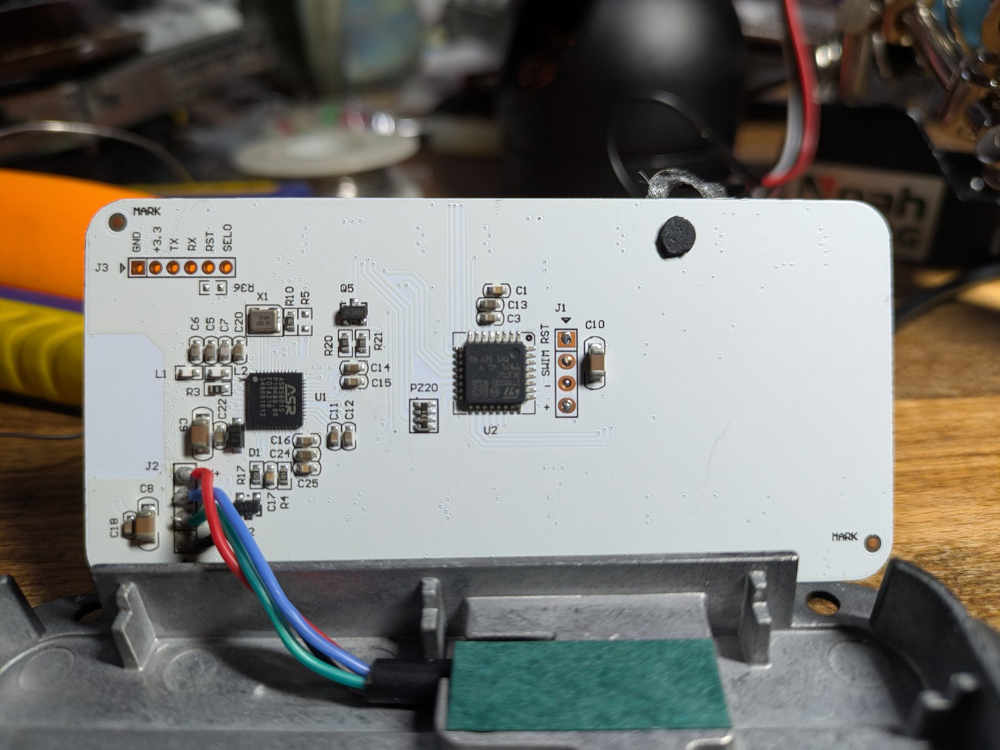

# Button panel



The panel is a two-processor design, and the split is the single most useful
thing to understand about it.

```
             ┌──────────────────────────────────────────────┐
   buttons → │ ASR5601S   main controller                   │
             │  · scans 8 buttons                           │
             │  · runs the UI / modes                       │
             │  · 2400-baud base link (UART1, P04/P05)      │
             │  · optional BLE                              │
             │  · 115200 display link (UART2/3)             │
             └───────────────┬──────────────────────────────┘
                             │ 9-byte 0x5A…0xEE, 115200
             ┌───────────────▼──────────────────────────────┐
             │ STM8S003K3   RGB LED driver                  │
             │  · 24 GPIOs, all outputs                     │
             │  · 8 groups of 3 = 8 RGB LEDs                │
             │  · no buttons, no ADC, no PWM timer          │
             └──────────────────────────────────────────────┘
```

## Evidence for the split

- The STM8 firmware has **no GPIO input read and no button scan**. All 24
  descriptor pins are outputs.
- Its UART is 115200, not the 2400-baud base link.
- Its RX frame is a 9-byte display frame (`0x5A … 0xEE`), and the 24 pins are
  driven as 8 groups of 3 from its 8 nibbles.
- The 8 buttons cannot fit on the STM8: apart from the 24 LED pins, only PD7
  would be free.
- The earlier live capture (panel connected to the base) shows the panel
  sending `08 0C` button frames, so a button scanner exists. The only IC that
  can do it is the ASR.

## Why the status LEDs stay dark without the base

With the panel powered but the base disconnected, the backlight is on but
pressing a channel does nothing to the RGB status LEDs. That is expected:

- The ASR is the LED authority; it computes the colours and sends display
  frames to the STM8.
- Its UI appears to wait for the base's startup frame (`0x1B`) and/or the
  replies to its `07`/`08` frames before advancing the display.
- With no base, the ASR sits in a "no link" state.

The stock base sends one unsolicited `0x1B` at boot:

```
00 FF 1B 02 00 00 00 00 00 00 1C
```

`rp2040/base_emulator.py` sends that frame (alternating a couple of inferred
flag values) and answers panel frames with the stock `18` / `17` replies, so the
panel can be exercised on the bench.

We have not proven that the ASR requires *that exact* frame; it may simply need
any valid base reply. The emulator is the experiment.

## Controlling the LEDs

There are two very different levels of control.

### Over J2 only (stock panel)

- You can read every button frame and every base reply.
- You can modify/inject the base replies with a MITM.
- **There is no known command on the 2400-baud bus that sets an LED.** The
  replies echo the panel's request payload; they do not carry LED colours.
- Consequently, a J2-only gateway can read buttons and drive the base outputs,
  but it cannot arbitrarily flash a status LED.

### Over the private display link

- The ASR → STM8 link is 115200 and carries the 9-byte display frame.
- Injecting that frame **does** set the 8 LED colours (8 nibbles).
- This requires tapping the private link (two wires), which is outside a
  J2-only build.
- It is the reliable path for a CAN-driven "flash this light" feature.

For the gateway/PDU product, treat the display-link tap as a deliberate design
addition: it is the difference between observing the panel and fully controlling
it.

## What is still unknown

- The ASR firmware has not been dumped. Its button/UI logic is the remaining
  black box.
- Whether any hidden 2400-baud command can influence the LEDs (possible, but no
  evidence yet).
- The exact colour mapping of the 8 display nibbles (needs a bench test).
- Whether the ASR's display UART is UART2 or UART3 (identify by continuity from
  STM8 PD5/PD6).

See [asr5601.md](asr5601.md) for the ASR pinout, boot mode, and dump options.
